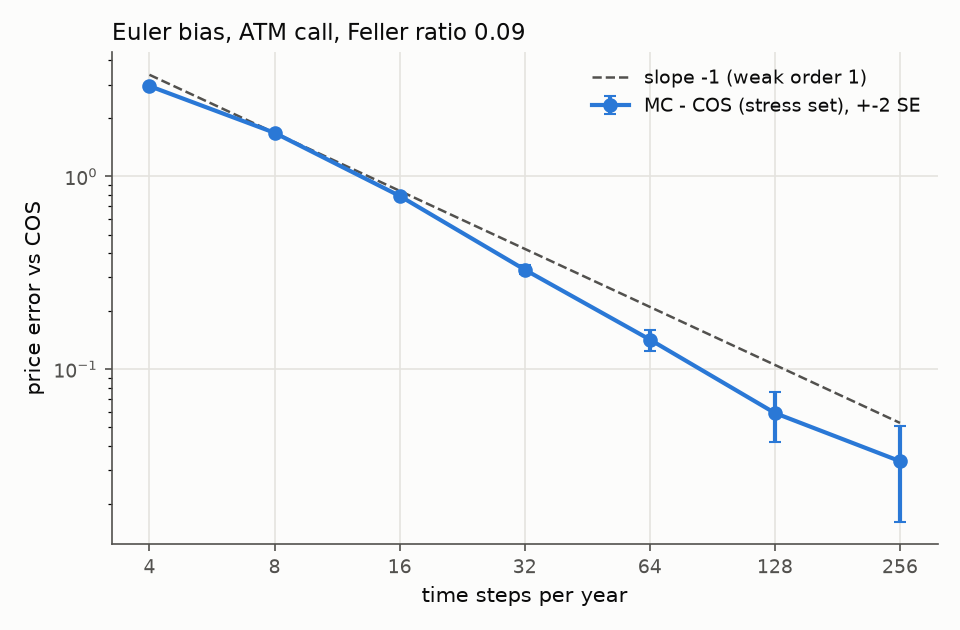
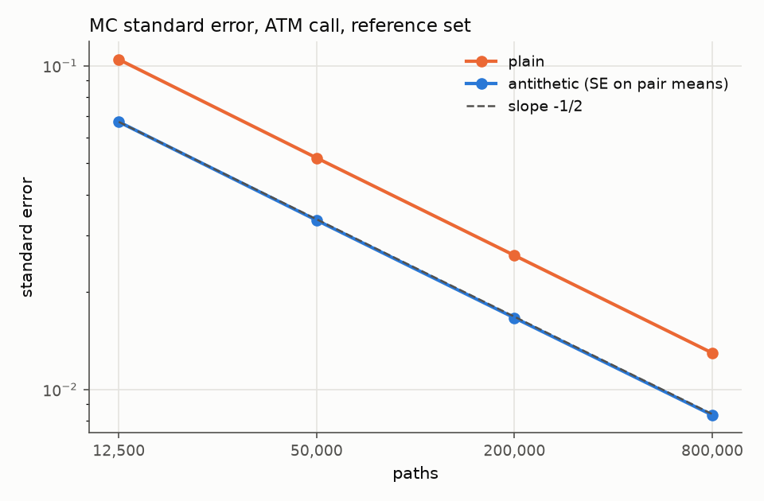

# heston-autocallable

Pricing and risk for an autocallable structured product under the Heston stochastic-volatility
model, in pure NumPy/SciPy (vectorized; no C++, no Numba).

> Status: all 7 stages complete (semi-analytic European pricer, Monte Carlo, autocallable,
> implied vols and calibration, Greeks, convergence study, dashboard).

## Model

    dS = (r - q) S dt + sqrt(v) S dW1
    dv = kappa (theta - v) dt + xi sqrt(v) dW2,      corr(dW1, dW2) = rho

Reference parameters: S0 = 100, r = 0.03, q = 0, v0 = 0.04, kappa = 2, theta = 0.04,
xi = 0.3, rho = -0.7 (`hestonlib.REFERENCE`).

## Semi-analytic European prices (`hestonlib.analytic`)

* **Characteristic function** of ln(S_T/F_T) in the Albrecher et al. (2007) "little Heston
  trap" form (root choice with `exp(-dT)`), which keeps the complex logarithm on a single
  branch even for long maturities, high vol-of-vol and rho near -1.
* **Lewis (2001) single integral** along Im(z) = -1/2, evaluated with `scipy.integrate.quad`
  (scalar strike) or `quad_vec` (vector of strikes, one adaptive pass).
* Puts come from put-call parity.

```python
from hestonlib import REFERENCE
from hestonlib.analytic import heston_call, heston_put
heston_call([90, 100, 110], 1.0, REFERENCE)
```

## Monte Carlo (`hestonlib.mc`)

* **Full-truncation Euler** on ln S (Lord, Koekkoek and van Dijk, 2010): v+ = max(v, 0) enters
  the drift and diffusion of both processes, and the raw v is carried forward. On the log
  scale, the discounted forward is an exact martingale of the discrete scheme.
* **Antithetic variates** flip both independent drivers together. The standard error is
  computed from the n/2 pair means, which are independent.
* **Coupled levels and common random numbers**: normals are drawn on a fine grid
  (`rng_steps`) and summed per step, so runs with different step counts share one Brownian
  path, and runs with different parameters share the same normals.
* Every estimate is an `MCResult(price, se, n_samples)`.

```python
from hestonlib import REFERENCE
from hestonlib.mc import mc_european
mc_european([90, 100, 110], 1.0, REFERENCE, n_steps=64, n_paths=200_000, seed=1)
```

The Euler bias is tested in two ways. On coupled levels with Feller strongly violated, the
price falls by a statistically significant amount at every halving of dt. At the reference
parameters, the 64-step price matches the COS oracle within 4 SE plus a bias allowance
|MC(32) - MC(64)| + 4 SE (the weak-order-1 estimate of the remaining bias).

## Autocallable (`hestonlib.autocall`)

Notional N, observation dates t_1 < ... < t_n = T, and levels relative to S0:

* **Autocall:** at each t_i, if S_{t_i} >= B S0, the note pays N (1 + c i) at t_i and
  ends. The maturity date is an autocall date.
* **Redemption if never called (European knock-in, observed at T only):** N if
  S_T >= KI S0, and N S_T / S0 otherwise.
* **Discounting:** every cashflow is discounted at exp(-r t) for its own date.

`price_autocallable` returns the price and SE. It also reports the per-date call
probabilities, P(never called), P(loss) and the expected life, each with its SE.

<!-- numbers-from: scripts/price_autocallable.py -->
Reference note: annual dates over 3 years, B = 100%, KI = 60%, c = 8%, under the reference
Heston parameters (`scripts/price_autocallable.py`, 1,000,000 antithetic paths, seed 2026):

| steps | price | SE |
|---|---|---|
| 12 | 99.4262 | 0.0151 |
| 48 | 99.5063 | 0.0150 |
| 192 | 99.5144 | 0.0150 |

On one shared Brownian path:
* MC(12) - MC(48) = -0.0801 +- 0.0088.
* MC(48) - MC(192) = -0.0081 +- 0.0059.

At 192 steps:
* P(called at year 1, 2, 3) = 0.5799, 0.1200, 0.0561.
* P(never called) = 0.2439.
* P(loss) = 0.0629.
* Expected life = 1.7201 +- 0.0006 years.

The probability SEs are 0.0002 to 0.0004.
<!-- end-numbers -->

How the pricer is validated:
* **One date:** the note is a bond plus a digital minus a put, priced by the COS oracle.
* **Several dates:** in the BS limit, against an exact discrete-monitoring price built from
  multivariate normal CDFs (Girsanov for the knock-in leg). That oracle is itself checked
  against quadrature and the trivariate orthant formula.
* **Exact payoff limits:** barrier 0, infinite barriers, KI 0 and KI infinite.

## Implied volatility and calibration

**Pricer error estimate.** `heston_call(..., return_error=True)` returns the Lewis
quadrature's error estimate (QUADPACK's estimate, not a rigorous bound) in price units,
plus a rounding term. `tests/test_implied_vol.py` checks that it covers the true error
against a COS oracle converged to < 1e-12.

**Guarded implied volatility** (`hestonlib.implied_vol`):
* `brentq` runs inside checked no-arbitrage bounds.
* A price whose time value is within its error bound gives NaN rather than a clipped
  volatility. This covers deep-OTM short-maturity Heston prices, which can be slightly
  negative.
* A price that violates the bounds by more than its error raises.

**Calibration** (`hestonlib.calibration`):
* Bounded least squares on vega-weighted price errors, which to first order are IV errors.
* Reported with each fit: parameter SEs from s^2 (J^T J)^-1, the correlation matrix, the
  scaled condition number, any parameter at a bound, and the Feller ratio (reported, not
  imposed).

<!-- numbers-from: scripts/calibrate.py -->
Example (`scripts/calibrate.py`): the reference parameters priced by the COS oracle on
4 maturities x 7 strikes, with N(0, 0.002^2) noise added to the IVs (seed 2026).

| param | truth | fit | SE |
|---|---|---|---|
| v0 | 0.0400 | 0.0398 | 0.0004 |
| kappa | 2.0000 | 1.9112 | 0.1951 |
| theta | 0.0400 | 0.0403 | 0.0005 |
| xi | 0.3000 | 0.2871 | 0.0165 |
| rho | -0.7000 | -0.7160 | 0.0269 |

* Every parameter is within 0.78 SE of the truth (max |z| in the script output).
* IV RMSE is 0.00153 and the Feller ratio is 1.868.
* The scaled condition number is 24.4.
* kappa is the least identified parameter (SE 0.1951 on a fit of 1.9112). Its largest
  correlation is with xi (0.59), and xi in turn correlates with rho (0.78).
<!-- end-numbers -->

Without noise, the same fit recovers both the reference set and a Feller-violating stress
set to within a bound derived from sigma_min of the Jacobian.

## Greeks (`hestonlib.greeks`)

Bump-and-revalue with **common random numbers**: every scenario uses the same seed. Each
Greek's SE comes from its own per-path differences, taken on antithetic pair means. The
note's fixing (`ref_spot`) stays put while spot is bumped. The payoff is scale invariant,
so bumping both would give zero delta.

| Greek | bump |
|---|---|
| delta, gamma | 2% of the fixing |
| vega | parallel 1-vol-point shift of sqrt(v0) and sqrt(theta) |
| rho | 1e-3 in r |

The bumps are sized against the barrier discontinuities. An exact BS oracle puts the
finite-difference truncation bias below a quarter of the Greek's SE at 400k paths. Smaller
spot bumps inflate the gamma variance, which grows like 1/h^3 for a digital-type jump.

<!-- numbers-from: scripts/greeks.py -->
Reference note (`scripts/greeks.py`, 48 steps, 1,000,000 antithetic paths, seed 2026):

| Greek | value | SE |
|---|---|---|
| price | 99.5159 | 0.0150 |
| delta | 0.2757 | 0.0016 |
| gamma | -0.0160 | 0.0016 |
| vega (per unit vol) | -49.9824 | 0.2765 |
| rho (per unit rate) | -94.5984 | 1.0356 |
<!-- end-numbers -->

<!-- numbers-from: scripts/greeks.py scripts/price_autocallable.py -->
This run's 48-step price (99.5159) is not identical to the pricing script's 48-step price
(99.5063). The pricing script draws its normals on a 192-step grid, so the two runs share
only part of their random stream. Each SE is 0.0150.
<!-- end-numbers -->

How the Greeks are tested:
* In the BS limit, against the same finite difference of the MVN oracle.
* For one Heston date, against the same finite difference of the COS replication, with an
  Euler bias allowance and a power cap.
* Over 200 seeds, the reported SEs match the observed spread.

## Convergence study (`scripts/convergence.py`)

<!-- numbers-from: scripts/convergence.py -->
ATM European call, T = 1, against the COS oracle. 400,000 antithetic paths, seed 2026.
All step counts share one Brownian path, drawn on a 256-step grid.



| steps | stress: MC - COS | SE | reference: MC - COS | SE |
|---|---|---|---|---|
| 4 | +2.9462 | 0.0170 | +0.0868 | 0.0133 |
| 8 | +1.6854 | 0.0123 | +0.0299 | 0.0125 |
| 16 | +0.7929 | 0.0099 | +0.0152 | 0.0121 |
| 32 | +0.3286 | 0.0091 | +0.0075 | 0.0119 |
| 64 | +0.1426 | 0.0088 | +0.0056 | 0.0118 |
| 128 | +0.0593 | 0.0087 | +0.0064 | 0.0118 |
| 256 | +0.0333 | 0.0086 | +0.0085 | 0.0118 |

**Stress set (Feller ratio 0.09).** The bias is resolved at every level. The paired change
per halving of dt, D(n) = MC(n) - MC(2n), is:

| step change | D(n) | SE(D) |
|---|---|---|
| 4 to 8 | +1.2608 | 0.0154 |
| 8 to 16 | +0.8925 | 0.0107 |
| 16 to 32 | +0.4643 | 0.0082 |
| 32 to 64 | +0.1861 | 0.0069 |
| 64 to 128 | +0.0833 | 0.0062 |
| 128 to 256 | +0.0259 | 0.0056 |

The first two changes are pre-asymptotic. The 16-to-32 change is about half the 8-to-16
change, as weak order 1 predicts. From 32 steps on, each change is less than half the
previous one, so the decay is currently faster than order 1. The slope -1 guide in the
figure lies above the data there.

**Reference set.** The bias is resolved only on coarse grids. The paired changes are:
* +0.0568 +- 0.0082 from 4 to 8 steps;
* +0.0148 +- 0.0053 from 8 to 16;
* +0.0077 +- 0.0033 from 16 to 32.

From 32 steps on, the changes are of the order of their SEs: +0.0019 +- 0.0022,
-0.0008 +- 0.0015 and -0.0021 +- 0.0010. The last one has the "wrong" sign for a monotone
bias, but at about 2 SE it is consistent with noise.
<!-- end-numbers -->



<!-- numbers-from: scripts/convergence.py -->
| paths | SE antithetic | SE plain | variance ratio plain/anti |
|---|---|---|---|
| 12,500 | 0.06712 | 0.10461 | 2.43 |
| 50,000 | 0.03333 | 0.05193 | 2.43 |
| 200,000 | 0.01665 | 0.02595 | 2.43 |
| 800,000 | 0.00833 | 0.01297 | 2.42 |

The log-log slope of the antithetic SE against path count is -0.502 (theory -0.5). Since
SE = s / sqrt(m), a slope near -0.5 holds almost by construction. The evidence that the
SEs are right comes from the tests that compare reported SEs with the spread over many
seeds (test_mc for prices, test_greeks for Greeks).
Antithetic pairs cut the variance by a factor of 2.42 to 2.43 at equal path counts. The
antithetic SE is computed from pair means.
<!-- end-numbers -->

Check every number in the marked README blocks against fresh script output with
`.venv/bin/python scripts/check_readme.py`.

## Dashboard (`app/dashboard.py`)

    .venv/bin/streamlit run app/dashboard.py

The sidebar sets the Heston parameters, the spot and the note's fixing, the product
(maturity, observation frequency, barrier, knock-in, coupon) and the MC settings (steps per
year, paths, seed). The page has three tabs:

* **Price:** the price with its SE and 95% interval, P(never called), P(loss), the expected
  life, and the per-date call probabilities, each with its SE.
* **Greeks:** delta, gamma, vega and rho on demand, using the CRN bumps described above,
  each with its SE.
* **Smile:** Black-Scholes implied vols of the semi-analytic Heston prices. Quotes whose
  time value is within the pricer's error estimate are left blank.

The Feller ratio is shown alongside. The computations are plain functions, tested against
the exact BS oracle. The whole app is run headless in the test suite through Streamlit's
`AppTest`.

## How correctness is established

The tests never use the package's own output as an expected value. The ground truth is:

1. **An independent oracle** (`tests/reference.py`, which does not import `hestonlib`):
   Fang–Oosterlee COS method for puts and digitals, and its own Black-Scholes formula.
   The oracle's closed-form CF is itself checked against a numerical integration of the
   Heston Riccati ODEs, and its truncation range is widened until prices stop changing.
   This was needed: a fixed cumulant-based range under-truncates when Feller is badly violated.
2. **The Black-Scholes limit**: with v0 = theta and xi -> 0, the gap to BS(sqrt(v0)) shrinks
   linearly in xi, and quadratically when rho = 0, as the vol-of-vol expansion predicts.
3. **Model-free identities**: put-call parity (package call vs oracle native put),
   no-arbitrage bounds, and monotonicity and convexity in strike.

Run the suite with `.venv/bin/python -m pytest -q`.

## Development

See `CLAUDE.md` for the project rules. A Claude Code Stop hook (`scripts/check.sh`) runs the
full suite whenever an agent turn ends, and blocks completion on failure.
